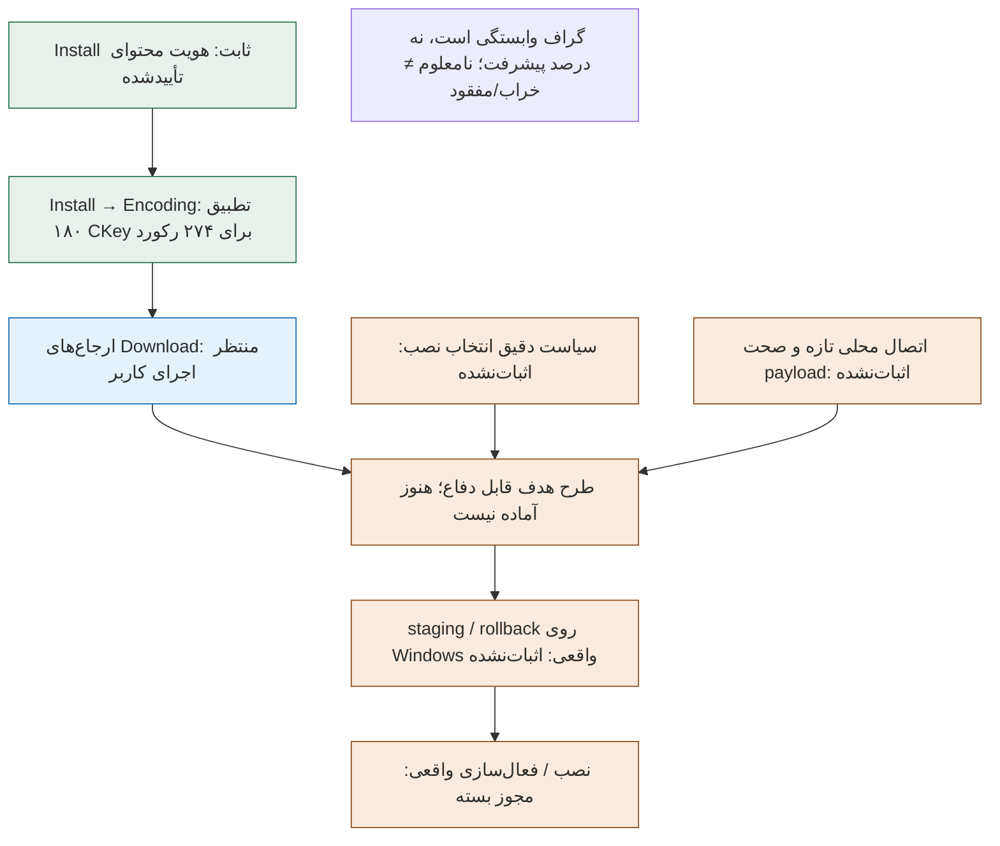

# وضعیت جلسه: Install → Encoding و گام تطبیق Download

این سند ادامهٔ checkpoint قبلی دریافت محدود Install است. مرجع جاری پژوهش است، نه ادعای آماده‌بودن آپدیتر یا رونویسی لفظ‌به‌لفظ گفتگو. تغییرات این سینک فقط روی شاخهٔ patch-audit-20261016 است؛ main، release و workflow تغییر نمی‌کنند.

## نتیجهٔ تازه
- فایل Install ثابت بیلد 12.1.5.70391، شامل ۲۷۴ رکورد و ۱۸۰ CKey یکتا، با هویت قبلاً تأییدشده حفظ شد. همهٔ گونه‌های هم‌نام/منطقه‌ای باقی ماندند.
- گزارش ارسالی کاربر از install-encoding-links-2 وضعیت pinned_install_encoding_metadata_links_reviewed دارد. تمام ۱۸۰ CKey با ارجاع و اندازهٔ decoded در Encoding توافق داشتند؛ هیچ مورد حل‌نشده یا اختلاف اندازه در این گزارش نیست.
- تطبیق مستقل آفلاین، مجموعهٔ دقیق کلیدها، همهٔ اندازه‌ها و شمارش‌های گزارش را با Install pin‌شده کنترل کرد؛ ۷ تغییر منفی مصنوعی در گزارش هم رد شدند.
- اجرای گزارش‌شده هویت کامل Encoding و checksum صفحه‌های منتخب را کنترل کرده، اما تمام صفحات را از نظر معنایی parse نکرده است. ۶۴ بایت tail تفسیرنشده گزارش شده؛ آن را خراب اعلام نمی‌کنیم.
- در این ادامهٔ آفلاین، بدنهٔ Encoding/Download واقعی در محیط دستیار دوباره خوانده نشده، هیچ آرشیو یا بازی/Lab کاربر باز/تغییر داده نشده و هیچ دریافت بازی/CDN انجام نشده است.

## اصلاح دقیق Windows
نسخهٔ نخست هنگام کنترل Install کوچک با install_changed متوقف شد. تشخیص واقعی کاربر روی Windows / Python 3.13.16 نشان داد MD5 و SHA256 درست‌اند، هر کانال path و handle جداگانه ثابت مانده و فقط st_ctime_ns بین stat و fstat متفاوت است.

در نسخهٔ ۲، fingerprint کامل path با path و fingerprint کامل handle با handle قبل/بعد مقایسه می‌شود. ctime از هیچ کنترل زمانی حذف نشده؛ فقط پل مقایسهٔ دو API روی Windows آن را کنار می‌گذارد. st_dev، st_ino، st_size، st_mtime_ns و st_nlink و تمام pinها همچنان الزامی‌اند. نتیجهٔ موفق کاربر بعد از این اصلاح ثبت شده است؛ دستیار اجرای بومی Windows را شخصاً انجام نداده است.

## پژوهش عمومی و حد قطعیت آن
TACTSharp در parser مستقیم Install، بیت‌های هر بایت را پیش از BitArray معکوس می‌کند و از تفسیر MSB-first پشتیبانی مستقل می‌دهد. CascLib در مسیر Install تگ‌ها را رد می‌کند؛ کد Download آن به‌تنهایی سند policy نصب نیست. TACTTool ابزار استخراج است و ترجیح US آن به‌عنوان policy نصب EU پذیرفته نشد. TACT.Net بعضی رکوردهای هم‌نام را در dictionary نام نگه نمی‌دارد؛ این رفتار هم پذیرفته نشد. یک parser عمومی Rust تفسیر LSB-first مخالف دارد؛ اجماع یا تأیید رسمی ادعا نمی‌شود.

commitهای ثابت و hash متن‌های بررسی‌شده در EVIDENCE.json نسخهٔ ۲ ثبت‌اند. هیچ کد کتابخانهٔ خارجی یا downloader آن اجرا نشده است. این پژوهش متن عمومی از مجوز یک‌بارهٔ دریافت متادیتای بازی جداست؛ مجوز دریافت قبلی مصرف شده و مجوز جدیدی ایجاد نمی‌کند.

## گام آمادهٔ بعدی؛ نیازمند اقدام سیستم کاربر
بستهٔ Install-Download-Coverage-1.zip ساخته و از ZIP استخراج‌شده آزمایش شد:
1. استخراج کامل در پوشهٔ تازه بیرون از بازی و Lab، بدون مخلوط‌کردن نسخه‌های قدیمی.
2. اجرای CHECK-INSTALL-DOWNLOAD.cmd؛ پس از تأیید محدوده، انتخاب Lab موجود، نه پوشهٔ بازی.
3. ارسال INSTALL-DOWNLOAD-COVERAGE-to-share.json از Results جدید؛ در توقف فقط متن تشخیص، بدون تغییر مجوزها یا تکرار اسکن.

این ابزار فقط objects/5beff4cf8122da27a6788d9062c8d3c2-74562151.decoded را در یک گذر ترتیبی تا 74,562,151 بایت می‌خواند. MD5 و SHA256 و هدر/کاتالوگ مرتب pin‌شده باید تأیید شوند. فقط EKeyهای مراجع ثابت نگه داشته می‌شوند؛ inventory عمومی ایجاد نمی‌شود. متادیتای Encoding، inventory و هیچ فایل بازی/آرشیو خوانده نمی‌شوند. شبکه یا تغییر بازی/Lab وجود ندارد؛ تنها یک گزارش تازه در پوشهٔ جداگانهٔ بسته نوشته می‌شود.

موجود نبودن فایل دقیق یا نبود EKey، نامعلوم است، نه مفقود/خراب بودن بازی. همهٔ EKeyهای جایگزین حفظ می‌شوند و هیچ‌یک برای نصب انتخاب نمی‌شود. اندازهٔ encoded در Download با اندازهٔ decoded در Install برابر فرض نمی‌شود. پروفایل Windows/x86_64/EU/enUS تاریخی است و در این گام دوباره اعتبارسنجی نمی‌شود. انتخاب matching-or-unclassified همچنان فقط تشخیصی است.

## آزمون‌ها و منشأ
- install-encoding-links-2: ۶۹ آزمون Linux موفق؛ همان ۵۹ آزمون پیشین به‌اضافهٔ ۱۰ آزمون اصلاح هویت، نه ۱۲۸ آزمون مستقل.
- ابزار coverage تازه: ۴۰ آزمون Linux موفق و رگرسیون ۶۹تایی هویت هم در این مرحله دوباره موفق. هر دو مجموعه از ZIP استخراج‌شده اجرا شدند.
- مسیر مثبت Download/Encoding در تست‌ها مصنوعی و با جایگزینی صریح pin در تست است؛ CLI تولیدی override ندارد.
- اجرای مثبت واقعی ابزار coverage و اجرای بومی Windows آن هنوز انجام نشده است.
- لاگ‌های ۴۳ و ۳۳تایی مراحل ساختار/انتخاب قبلی تاریخی‌اند و در این سینک دوباره اجرا نشده‌اند. همهٔ اعداد قدیمی مخزن هم به‌عنوان تاریخچه حفظ شده‌اند، نه دوباره تأییدشده.

## گراف گیت‌ها
گراف وابستگی است، نه درصد پیشرفت و نه نمودار زمان‌بندی.

نسخهٔ HTML تعاملی: [updater-status-graph.html](updater-status-graph.html). منبع Mermaid هم در UPDATER-DEPENDENCIES.mmd موجود است. پیش‌نمایش دسکتاپ/موبایل/تم تیره بررسی بصری شده؛ گزارش محدودیت تست تعامل در GRAPH-QA.json است.

## گیت‌های همچنان بسته
سیاست کامل ترکیب تگ‌ها و انتخاب پیش‌فرض/اختیاری محصول؛ مجموعهٔ واقعی لازم برای نصب؛ اتصال تازهٔ پروفایل و snapshot؛ صحت محتوای محلی؛ طرح staging/rollback و بازیابی شکست روی Windows واقعی؛ و نهایتاً اجازهٔ صریح نصب/فعال‌سازی.

installation_ready=false، apply_authorized=false و required_network_download_bytes=null باقی می‌مانند. این سینک مجوز دانلود، اسکن، خواندن آرشیو، CASC writer یا تغییر بازی نیست.

## دامنهٔ سینک و ادامهٔ قابل بازسازی
منابع ابزارها، تست/لاگ‌ها، مراجع عمومی محدود، شواهد تطبیق و رسید hash بسته‌ها در research/install-reference-links-20261017 ثبت شدند. باینری متادیتای Blizzard، ZIP تحویلی، کل Lab، PRIVATE، transcript خام، credential و مسیر نصب کاربر وارد مخزن نشدند. این snapshot پژوهشی است، نه release؛ تست‌های متکی به Install واقعی به همان فایل کوچک داخل بستهٔ تحویلی قبلی نیاز دارند و نباید برای تهیهٔ آن دانلود یا جست‌وجوی خودکار اضافه کرد.
